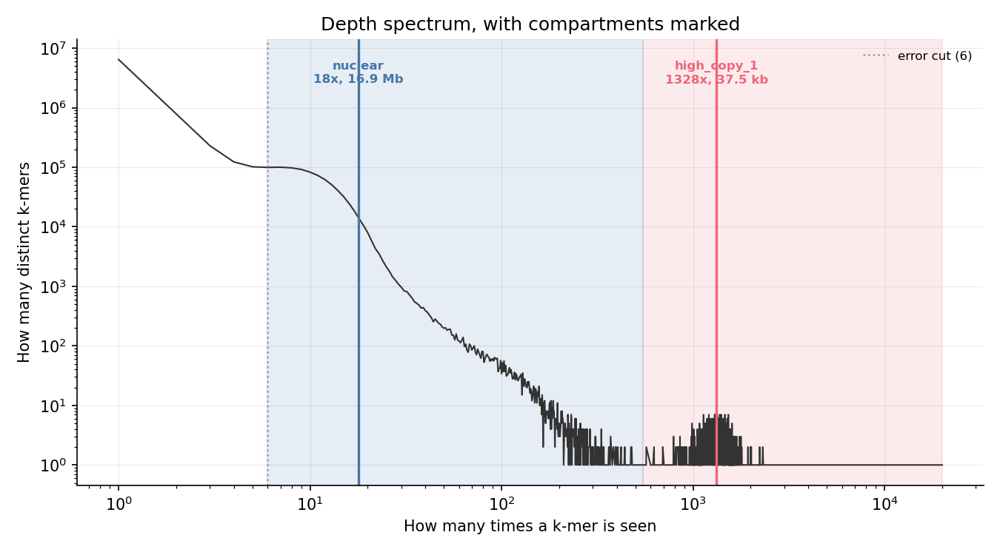
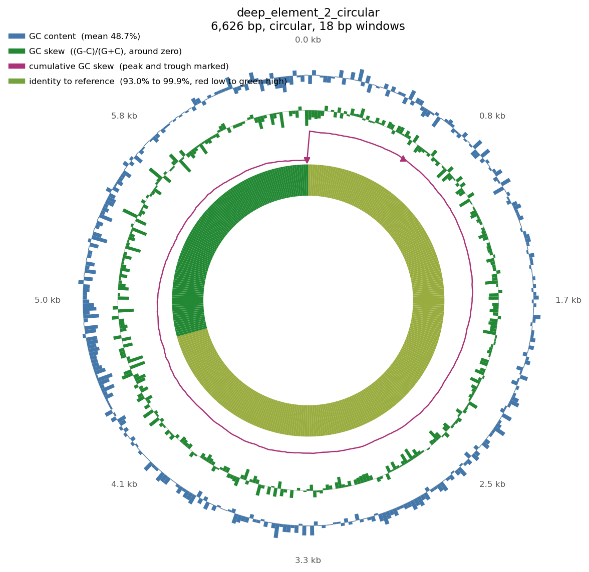
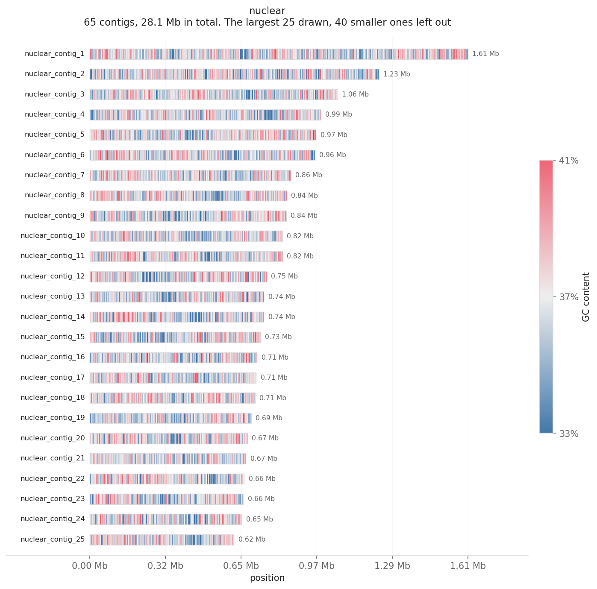
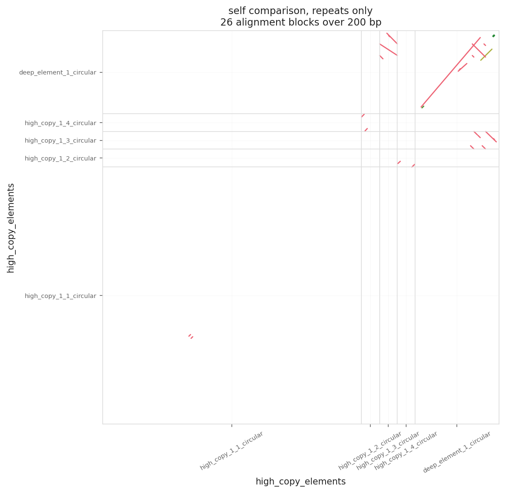
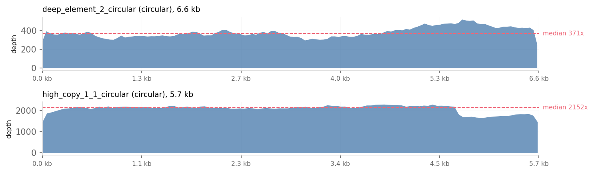
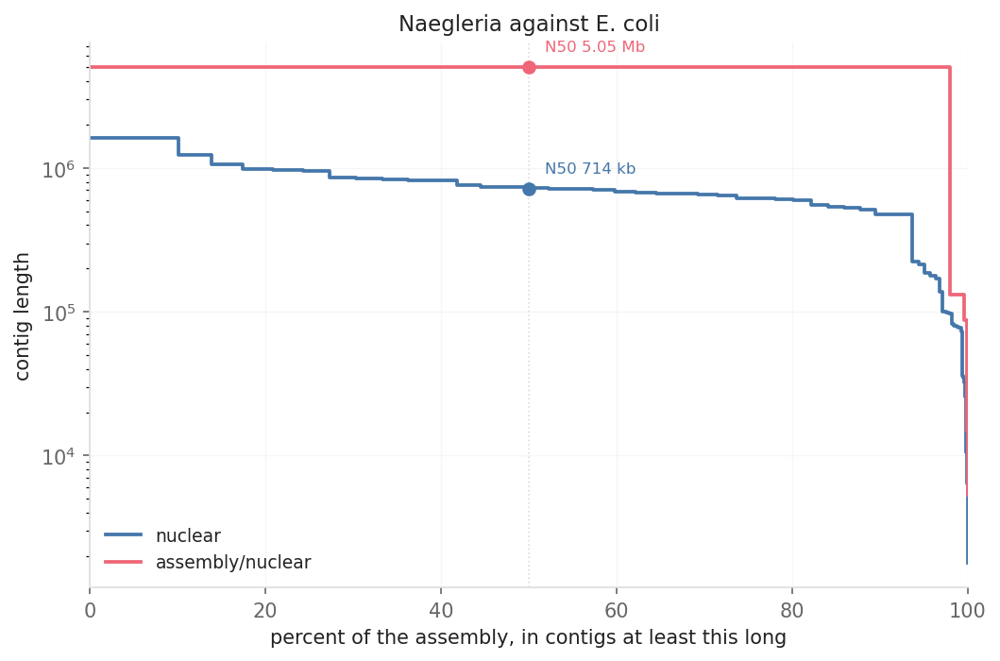
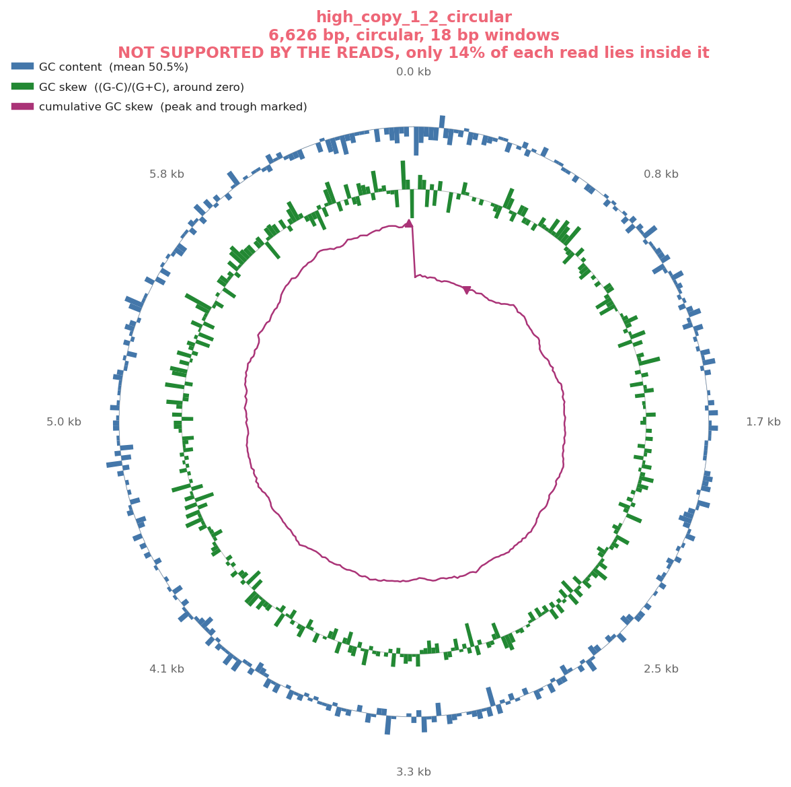

# nagasm

An assembly pipeline built around the way Naegleria keeps its DNA.

Most assemblers assume that coverage is roughly even across a genome. Naegleria
breaks that assumption, and it breaks it badly enough that general tools
struggle. This one sorts reads into compartments by depth before it assembles
anything, so the small circles that Naegleria carries in thousands of copies stop
getting in the way of the chromosomes.

Nothing in the method is specific to Naegleria, and it has been run on bacteria
too. See [on bacteria, which is where it broke](#on-bacteria-which-is-where-it-broke)
for what came out and the three bugs it exposed.

Everything here runs on public data and you can reproduce the results below with
two commands.



That plot is the whole idea in one picture. The big hump on the left is the
nuclear genome. The spike on the right is the mitochondrial genome, sitting at
seventy times the depth. On a normal linear plot you would never see it.

## The problem

Naegleria does not keep its ribosomal RNA genes on its chromosomes. They sit on
their own small circle of DNA, and the cell holds something like four thousand
copies of it. The mitochondrial genome is a second circle, also in many copies.

Think about what that does to a pile of reads. The nuclear genome is about 29.5
Mb and sits at whatever depth you sequenced to. The circles are a fraction of a
percent of that length, but because of their copy number they can account for a
large share of the reads. In the public dataset used below, one circle of 49 kb
pulled in more than one read in six.

Hand that to an ordinary assembler and it has a hard time, because almost
everything an assembler does assumes that unusually deep sequence is a repeat to
be collapsed.

This is not a guess. The team who produced the 2019 nanopore assembly of this
organism ran into exactly this. They wrote that these high coverage elements made
the combined assembly perform poorly, so they pulled those reads out and
assembled them separately.

Their way of pulling them out was to map reads against a known rDNA circle from a
related species and throw away whatever stuck. That works, but it needs you to
already have the answer. If you are working on a new isolate, or a relative
nobody has sequenced yet, there is no reference circle to map against.

So this pipeline finds the compartments in the reads themselves.

## What this is, and what it is not

It is a pipeline, not a new assembler. The hard work of building chromosomes
from reads is done by [Flye](https://github.com/fenderglass/Flye), or by SPAdes
when you give it short reads, and the polishing is minimap2 and racon. Those
tools are good and we are not trying to replace them.

What the pipeline adds is everything that happens before and after them. It
decides, with no reference, which reads belong to a separate molecule rather
than to a chromosome. It assembles those small circles itself, because they are
a different enough problem to be worth it. Then it checks whether the reads
really support each element it reports, instead of assuming that deep sequence
means a free molecule.

Roughly, and counting lines of code that are not blank or comment:

| | Lines | |
|---|---|---|
| Sorting reads into compartments | 454 | ours |
| Assembling the small circles | 686 | ours |
| Checking the reads support an element | 177 | ours |
| A chromosome assembler, for reading | 176 | ours, and not competitive |
| k-mer counting and sketching, in Rust | 804 | ours |
| Handing nuclear reads to Flye or SPAdes | 244 | a wrapper |
| Polishing with minimap2 and racon | 176 | a wrapper |
| Scoring gene content with BUSCO | 297 | a wrapper, and optional |

So about 2,300 lines of method and about 720 lines of wrapper, plus the
plumbing that reports it all. Useful to know before you decide whether to
trust it, and useful to know which part to blame when something goes wrong.

## The question it answers

One question, asked before anything is assembled:

> **Which of these reads come from a molecule that is not the chromosome, and
> which only look that way?**

Everything else follows from that. If you can answer it with no reference, you
can pull a mitochondrion and an rDNA circle out of a new isolate nobody has
sequenced. If you answer it badly, you either leave those circles in and let
them wreck the chromosome assembly, or you take out real chromosomal sequence
and quietly damage the result.

The second half of that question is the part most tools skip, and it is where
we were wrong for a while. Deep sequence is not always a separate molecule. In
a bacterium it is usually a repeat sitting inside the chromosome. So the
pipeline now asks the question twice, once from the reads before assembly and
once from the assembled element afterwards, and only an element that passes
both is allowed to take its reads out of the main pile.

Two questions it does **not** answer, said plainly so you do not expect them:

* **What is this element?** It will not tell you that a circle is a plasmid or
  a virus or a mitochondrion. It reports the sequence and the evidence. You do
  the annotating.
* **Is my assembly better than Flye's?** The chromosome assembly *is* Flye.
  The claim is about what happens either side of it.

## What makes it different

Four things, and the fourth is the one that took real work.

1. **It sorts reads before assembling, with no reference.** The usual way to
   get an organelle out of a read set is to map against a known one from a
   relative and keep what sticks. That needs you to already have the answer.
   This finds the compartments in the depth spectrum of the reads themselves.
2. **Each compartment gets the assembler it deserves.** Small circles go to our
   own assembler, which closes them and rotates them to a fixed start.
   Chromosomes go to Flye. One tool doing both jobs does neither well.
3. **It works in log space.** An rDNA circle at 4,000 copies and a chromosome
   at 20 times sit in the same histogram. On a linear axis the chromosome is
   the only thing you can see.
4. **It checks its own answers.** Every element it reports is measured back
   against the reads, and the number that does the work is how much of each
   supporting read lies inside the element. This is what separates a free
   circle from a chromosomal repeat, and it is the reason the bacterial runs
   are trustworthy. The details, and the honest account of which parts of the
   idea are borrowed, are in the bacterial section below.

## How it works, in more detail

### 1. Sorting reads by depth, with no reference

Count k-mers across the whole read set, then give every read the median count of
its own k-mers. Reads from a four thousand copy circle are built from k-mers seen
far more often than k-mers from a single copy chromosome, so that one number
already separates them.

To decide where the boundaries go we look at the k-mer count histogram. Each
compartment makes its own hump. The useful part is that the area under a hump
tells you how much distinct sequence sits at that depth, which is what tells a
large genome apart from a small element held in many copies.

That area is also what decides which compartment is the nuclear one. It is
simply the compartment covering the most distinct sequence. It is not the tallest
hump, and it is not the one with the most reads. On this organism those are
different things, and picking either of the easy ones gets it wrong.

One detail that turned out to matter a lot. The peak finding runs on the log of
the histogram. The compartments differ in size by three orders of magnitude, so
any rule of the form "ignore peaks shorter than some share of the tallest" throws
away exactly the compartment this tool exists to find. There is a test for that.

### 2. Each compartment assembled the way it deserves

Once the reads are sorted, the problem splits into pieces that are each much
easier than the whole.

The small circles become tiny problems with enormous coverage, which is friendly
enough that writing our own assembler for them is sensible. It finds overlaps,
walks them into a layout, works out whether the walk came back to where it
started, and rotates the answer to a fixed starting point so that two runs agree.

Circularity is measured rather than guessed. The walk watches for the read it set
out from, and the distance it covered getting back there is the length of the
circle. A general assembler usually hands you a line and leaves you to work out
whether its two ends mean it closed.

A compartment can hold more than one molecule, so after each element is
assembled, the reads belonging to it are set aside and whatever is left goes
round again.

The nuclear reads go to Flye or SPAdes. That is on purpose. Those tools are many
years of work on the hard parts of assembly and a hand written replacement would
be worse. There is one of our own in `olc.py` for reading, and you can switch to
it with `--engine nagasm`, but it is there to be understood rather than to
compete.

### 3. Anchors that are not ruined by an AT rich genome

Assemblers pick anchor k-mers to find overlaps between reads. The usual way takes
the smallest k-mer in a window by alphabetical order. A comes before C, G and T.

In a genome that is about two thirds A and T, that quietly means you keep
choosing runs of A. Those are everywhere, they say almost nothing about where you
are, and lining two reads up on one is close to meaningless.

So anchors are picked by a hash instead of by the alphabet, and any k-mer whose
own base composition is too lopsided is thrown out before it is ever considered.
There is a test that poly-A contributes no anchors at all.

## Does it work

### On real public data

The reads are from [PRJNA541227](https://www.ebi.ac.uk/ena/browser/view/PRJNA541227),
the nanopore run behind the 2019 assembly of Naegleria fowleri ATCC 30863. The run
below used the first 94,572 reads, which is 0.63 Gb, or about 21 times over the
nuclear genome. These are older nanopore reads with an error rate around ten
percent, which makes this a hard test rather than an easy one.

**The mitochondrial genome came out whole.**

| | Our assembly | Published |
|---|---|---|
| Length | 48,281 bp | 49,531 bp |
| Shape | closed circle | circle |
| Covers the reference | 97.8% | |
| Identity where aligned | 98.0% | |

That is against the published mitochondrial genome
([NC_021104.1](https://www.ncbi.nlm.nih.gov/nuccore/NC_021104.1)). Nothing
substantial is missing. The two percent that does not match is leftover nanopore
error, and it would come down with more polishing rounds or a handful of short
reads.

Of the reads that really do come from the mitochondrion, 97.1 percent were put in
the right compartment, with no reference used at any point.

**The rDNA circle came out too, and the story behind it is worth telling.**

| | Our assembly | Published |
|---|---|---|
| Length | 15,644 bp | 15,786 bp (strain LEE) |
| Shape | closed circle | circle |
| Covers the reference | 95.7% | |
| Identity where aligned | 98.1% | |

The published circle used for that comparison
([MT741533.1](https://www.ncbi.nlm.nih.gov/nuccore/MT741533.1)) is from a
different strain, so some of the difference is real biology rather than error.

What is interesting is that the depth sorting on its own did not find it. In this
library the rDNA sits at about eleven times the nuclear depth, which sounds like
plenty, but it is only fifteen kilobases of sequence. The hump it makes is tiny,
and it lands in the long tail of nuclear repeats that runs up from the nuclear
peak. It is a shoulder, not a peak.

Lowering the bar for what counts as a peak does not fix this. It shatters the
nuclear peak into a dozen imaginary compartments long before it finds the real
one. We tried, and it is in the git history.

What works is giving up on finding a shape and instead collecting every read more
than a few times deeper than the nuclear peak, then letting the assembler sort it
out. Most of what comes back is nuclear repeat and assembles into unremarkable
straight pieces. The one thing that closed into a circle was the rDNA.

That step only exists because the real data refused to behave like the synthetic
data. It is in `TriageResult.deep_outlier_indices`, with the reasoning written
next to it.

**Three smaller circles also came out, and we do not know what they are.**

They are about 3.3 kb each, they close cleanly, they are covered deeply, and
they share no sequence at all with each other, with either of the two circles
above, or with the published mitochondrial genome.

What we can say is that they are not chromosomal repeats. The read support check
described in the bacterial section below scores them at 0.41, 0.46 and 0.66
contained, meaning most of each supporting read lies inside the circle. Every
chromosomal repeat we have confirmed, in two different bacteria, scores between
0.00 and 0.14. So whatever these are, the reads behind them are not reads that
belong somewhere else.

That still does not say what they are. The pipeline reports them with their
numbers next to them and does not claim they are anything. Saying so is better
than quietly dropping them or quietly promoting them.

**The nuclear assembly stands up next to the published one.**

| | Our assembly | Published |
|---|---|---|
| Total length | 28,093,592 bp | 29.5 Mb |
| Contigs | 65 | 81 to 90 |
| N50 | 714,291 bp | 717,491 bp |

The published assembly used far more data than the 0.63 Gb subset here, so this
is not a claim that our nuclear assembly is better. The point is that the reads
left over after the circles are taken out still build into chromosome sized
pieces, which is what the sorting step is meant to protect.

Checking that assembly properly turned up a real bug in our own tool. A 48,897 bp
contig in the first nuclear run was a complete second copy of the mitochondrion.
The depth sorting had put 97.1 percent of the mitochondrial reads in the right
place, but the three percent it missed still came to roughly sixty times coverage
of a 49 kb molecule, which is plenty for Flye to rebuild it. Being nearly right
is not good enough when the leftovers are that deep.

The fix is to stop trusting depth alone. Once an element is assembled, every read
heading for the nuclear set is checked against it directly, and the ones that
match are dropped. That removed 1,980 reads. In the run above there is no longer
any contig matching the published mitochondrial genome, and the earlier output is
kept in the git history so the difference can be seen.

### On bacteria, which is where it broke

Nothing in the method is about Naegleria. The depth sorting does not know what
organism it is looking at. So we pointed it at two bacterial read sets that each
have a finished assembly of the same sample to check against, and it found three
bugs that Naegleria data had hidden completely.

The read sets are Klebsiella pneumoniae and Escherichia coli OXEC-73, both
nanopore, both with every replicon closed in the reference.

**The main assembly was fine from the start.**

| | Klebsiella | E. coli |
|---|---|---|
| Replicons in the reference | 4 | 7 |
| Replicons recovered | 4 of 4 | 7 of 7 |
| Contigs | 5 | 5 |
| N50 | 5,303,354 bp | 5,046,292 bp |
| Chromosome covered | 100% | 100% |

For E. coli the chromosome came back as one contig at 99.8 percent identity, the
131 kb and 87 kb plasmids as one contig each, and the two smallest plasmids as
tandem copies of themselves, which is a known habit of Flye on small circles
rather than anything we did. Two further plasmids came out of the element path,
matching the reference at 98 and 99 percent.

Use `--mode long_then_polish` for bacteria. Plain `long` mode skips polishing and
leaves the raw nanopore error rate in place, which looks like a bad assembly when
it is really an unpolished one. Also drop `--scale` to about 20, because a 5 Mb
genome contributes far fewer k-mers than a 30 Mb one.

**The elements were not fine, and the reason is interesting.**

In Naegleria, sequence that is much deeper than the rest of the genome really is
a separate molecule. That is the biology. The pipeline was built around it, and
somewhere along the way the inference stopped being an observation and became an
assumption baked into the code.

In a bacterium the same depth means something else entirely. Klebsiella carries
eight copies of its ribosomal RNA operon inside the chromosome, plus a scatter of
insertion sequences. That sequence is genuinely several times deeper than the
rest of the genome, so the depth sorting puts it in a high copy compartment and is
right to. It is simply not a separate molecule. Handed those reads, the circular
assembler closed four loops that do not exist, one of them a 6.5 kb sequence
stitched together from reads belonging to dozens of unrelated places in the
chromosome.

Nothing caught it, because nothing asked the obvious question afterwards: do the
reads actually support this?

**So now it asks.** `src/nagasm/support.py` maps the reads back to each assembled
element and measures two things, with no reference involved.

* **Depth.** How deeply the element is covered by the reads it came from. An
  element pulled out of a compartment sitting at hundreds of times the main
  genome cannot honestly come back covered twice. Three of the four Klebsiella
  circles were supported at under 3x and are caught here.
* **Containment.** For each read, what share of it lies inside the element. A
  read off a free circle matches along its whole length, because there is nothing
  else on that molecule to match. A read crossing the edge of a chromosomal
  repeat matches only in the middle, with unique chromosome either side that has
  nowhere to go.

Containment is the one that does the work. Depth alone would have failed on
E. coli, where every element came back between 415x and 5,420x, the real
plasmids and the artefacts alike.

| Organism | Elements | Verdict |
|---|---|---|
| Naegleria | 5 confirmed real | all kept, contained 0.41 to 0.93 |
| Klebsiella | 4 artefacts | all rejected, contained 0.00 to 0.03 |
| E. coli | 2 real, 4 artefacts | all 6 called correctly |

Fifteen of fifteen, across three organisms. The threshold sits at 0.20, with real
elements starting at 0.41 and artefacts topping out at 0.14, so nothing sits near
the line.

**The third bug was the expensive one.** An unsupported element was still having
its reads pulled out of the nuclear set, on the grounds that they were already
accounted for. On E. coli that removed about 48,000 reads, including every read
belonging to a real 5,167 bp plasmid, which was then represented only by a
chimera matching it at under half identity. A genuine replicon was destroyed while
the output still looked complete. Now only elements the reads support are allowed
to take reads away. The same run removes 1,003 reads instead of 48,000, the
plasmid comes back at 99.3 percent identity, and the assembly goes from 11
contigs to 5.

A failed element is reported with the reason written out, not deleted. A tool
that silently drops findings is worse than one that hands you a doubtful result
with the numbers attached.

**How this relates to work that already exists.** The signal is not new and we
want to be straight about that. A read that fails to align along its whole
length is evidence against the boundary it stops at, and that is the basis of a
family of assembly checkers.
[CRAQ](https://www.nature.com/articles/s41467-023-42336-w) is named Clipping
Reveals Assembly Quality and works from exactly this.
[metaMIC](https://genomebiology.biomedcentral.com/articles/10.1186/s13059-022-02810-y)
calls a read clipped once it has twenty unaligned bases and uses the rate of
those to place breakpoints. anvi'o flags positions where too many reads end
early. Doubling the target so junction reads have somewhere to land is also
ordinary practice, not a trick of ours. And the failure being caught is the
textbook one, since repeats are the known leading cause of circles that are not
there, with rRNA operons at five to seven kilobases in up to fifteen near
identical copies.

Three things here are different, and they are narrower than they look:

* **It measures the read, not the element.** The circular DNA field usually
  measures the other side of the alignment.
  [Circle-Map](https://link.springer.com/article/10.1186/s12859-019-3160-3)
  reports what share of the circle's bases the reads cover, and the
  [2018 human eccDNA atlas](https://www.nature.com/articles/s41467-018-03369-8)
  grades a call by requiring 95 percent of the region covered. Those ask how
  much of the circle the reads reach. We ask how much of each read the circle
  holds. On our Klebsiella chimera the target side number would have seen
  nothing wrong, because every base of it was covered. The reads just belonged
  elsewhere.
* **It is one number per element, used to decide whether the element exists.**
  The clipping tools ask where inside a contig an error sits, so they work
  position by position in windows. This collapses every read into a single mean
  and uses it as a yes or no on the element itself.
* **It runs against the whole library, not the compartment.** Judging an
  element by the compartment it came from is a rigged jury, because that
  compartment was selected for depth, meaning selected for reads that are
  mostly element sequence. The reads that give a repeat away straddle its
  edges, sit at ordinary depth, and were never in the compartment. On real
  E. coli data this was the difference between a repeat scoring 0.23 and
  scoring 0.10, which is the difference between keeping it and rejecting it.

So it is a known signal, aggregated differently, aimed at a question the tools
it comes from do not ask. That is the honest size of the claim. The check
behind it was four rounds of literature search rather than a systematic review,
and not finding something published is weak evidence that it is not published.
[CReSIL](https://academic.oup.com/bib/article/23/6/bbac422/6747811) and ECCFP
are where it would most likely already exist.

**What this says about other species.** It should work on anything where the
compartments you want differ in copy number from the bulk genome, which covers
mitochondria, chloroplasts, rDNA circles, plasmids and extrachromosomal elements
generally. The method never translates DNA, so there is no genetic code or codon
table to adjust for a new organism. What does change is how much of the deep
sequence is a separate molecule and how much is repeat living inside a
chromosome, and that is the question the support check now answers out loud
instead of assuming.

### On data where we know the answer

Real data tells you whether something works. Synthetic data tells you how well,
because you can compare against the truth.

The test below builds a read set shaped like a Naegleria library, with a
chromosome at ordinary depth and two circles far above it, then runs the whole
pipeline.

| Element | True length | Assembled | Identity |
|---|---|---|---|
| Nuclear | 300,000 bp | 299,986 bp | 99.89% |
| Mitochondrion | 12,000 bp | 12,002 bp | 99.75% |
| rDNA circle | 5,000 bp | 5,021 bp | 99.40% |

Those reads carry a two percent error rate. Every read was put in the right
compartment.

Separation holds up from clean reads to about five percent error, which covers
modern nanopore and PacBio HiFi. Above that it degrades, and the tool says so in
its own output rather than quietly handing you a wrong answer.

## Running it

You need [conda](https://docs.conda.io) or [mamba](https://mamba.readthedocs.io).
A Rust compiler is installed into the environment, so you do not need one
already.

```bash
git clone https://github.com/hafizmtalha/naegleria-assembler.git
cd naegleria-assembler

mamba env create -f environment.yml
conda activate nagasm
maturin develop --release
```

Look at your reads before assembling them. This takes about ten seconds and tells
you whether the compartments are really there.

```bash
nagasm triage reads.fastq.gz --scale 20
```

```
compartment       depth  vs nuclear         span     reads     GC
-----------------------------------------------------------------
nuclear             18x          1x  16,900,240    69,763  42.7%
high_copy_1       1328x         74x      37,460    23,754  33.3%
```

Then run the whole thing.

```bash
nagasm assemble --long reads.fastq.gz -o results --threads 8 --scale 20
```

Short reads instead, or as well:

```bash
nagasm assemble --short r1.fastq.gz r2.fastq.gz -o results
nagasm assemble --long ont.fastq.gz --short r1.fastq.gz r2.fastq.gz -o results
```

There is a Snakemake workflow too, if you prefer one.

```bash
snakemake --cores 8
```

### Pictures

**You get them without asking.** When a run finishes, it draws a circle for
every circular element, a karyotype of the chromosomes and a contiguity curve,
then prints the command to change them. Nothing in the assembly depends on any
of this, and a missing matplotlib or a sequence too short to draw ends in a note
rather than a failed run. Losing a finished assembly to a broken figure would be
absurd.

```bash
nagasm assemble -l reads.fastq.gz -o results --plots auto   # the default
nagasm assemble -l reads.fastq.gz -o results --plots all    # adds coverage and a dotplot
nagasm assemble -l reads.fastq.gz -o results --plots none   # draws nothing
nagasm assemble -l reads.fastq.gz -o results --plot-theme dark --plot-format svg
```

`auto` is cheap, since it reads only the assembly. `all` adds two minimap2 runs,
one for coverage and one for the dotplot, so it costs a few minutes on a big
read set.

**Then draw whatever else you want.** Everything is also a standalone command,
so you can keep going after the run without assembling again.

```bash
nagasm plot results/assembly/high_copy_elements.fasta --kind all -o figures
nagasm plot --help     # every option
```

#### The kinds

| `--kind` | What it draws | Needs |
|---|---|---|
| `auto` | circles if anything is circular, otherwise a karyotype | nothing |
| `circle` | one circular plot per sequence | reads and a reference are optional |
| `karyotype` | every contig as a bar, to the same scale | nothing |
| `dotplot` | a sequence against itself, or against a reference | minimap2 |
| `coverage` | read depth along each contig, drawn straight | reads, minimap2 |
| `nx` | the contiguity curve, of which N50 is one point | nothing |
| `all` | all of the above | as above |

#### Circles

One picture per sequence. Rings run from the outside in, and you can ask for any
subset.

| Ring | `--rings` name | What it shows |
|---|---|---|
| GC content | `gc` | GC per window, against the element's own mean |
| GC skew | `skew` | (G-C)/(G+C), drawn around zero |
| Cumulative GC skew | `cumulative` | the running total, peak and trough marked |
| Read depth | `depth` | coverage per window. Needs `--long` |
| Identity to reference | `identity` | red low, green high. Needs `--reference` |
| Not in reference | `missing` | windows with no alignment at all |

```bash
# reference free, the mode that matches the rest of the pipeline
nagasm plot results/assembly/high_copy_elements.fasta --kind circle -o figures

# add a depth ring, still reference free
nagasm plot results/assembly/high_copy_elements.fasta --kind circle -o figures \
  --long reads.fastq.gz --threads 8

# reference based, for a write up rather than for discovery
nagasm plot results/assembly/high_copy_elements.fasta --kind circle -o figures \
  --reference known_plasmids.fna --threads 8

# just two rings, rotated, no legend, as a vector file
nagasm plot element.fasta --kind circle --rings gc,cumulative \
  --no-legend --format svg --theme dark
```

**Which mode.** Reference free works on an isolate nobody has sequenced, which
is the whole point of the pipeline. Cumulative GC skew is the ring worth
reading, because a replicon that is genuinely replicated usually turns once at
the origin and once at the terminus. A collapsed repeat tends to show nothing of
the sort.

Reference based answers a different question, which is not whether your circle
is real but how it differs from one already published. It needs minimap2 and it
needs you to have the answer already.

Below is the E. coli plasmid p4 we recovered, drawn against the finished
reference for that same sample.



The inner ring is the useful part. It splits between a stretch matching the
reference at 99.9 percent and a stretch at 92 percent, real structure that a
single average identity figure would have hidden completely.

#### Karyotypes

Every contig as a bar, all to the same scale, shaded by GC or by read depth.
This is the picture that tells you at a glance whether you have a few
chromosomes or a heap of rubble.

```bash
nagasm plot results/assembly/nuclear.fasta --kind karyotype -o figures

# shade by read depth instead of GC
nagasm plot results/assembly/nuclear.fasta --kind karyotype -o figures \
  --colour-by depth --long reads.fastq.gz --threads 8

# pick out particular contigs, and draw more of them
nagasm plot results/assembly/nuclear.fasta --kind karyotype -o figures \
  --max-contigs 60 --highlight nuclear_contig_1 nuclear_contig_7

# sorted by name, greyscale, for print
nagasm plot results/assembly/nuclear.fasta --kind karyotype \
  --sort-by name --theme print --format pdf
```



Only the largest `--max-contigs` are drawn, and the subtitle says how many were
left out. A 65 contig assembly is readable. A 4,000 contig one is a black smear,
and drawing it honestly beats drawing it uselessly.

The GC scale follows your data rather than sitting at a fixed 25 to 75 percent.
On Naegleria, where nearly every window sits near 35 percent, a fixed band put
the whole picture in one colour and said nothing. The scale above runs 33 to 41
percent, and the variation is real.

Contigs that closed into a circle get a small ring after their name.

#### Dotplots

A sequence against itself shows its repeats, which are the thing that breaks
assemblies. The main diagonal is dropped, so everything left is a repeat.

```bash
nagasm plot element.fasta --kind dotplot -o figures --threads 8
nagasm plot assembly.fasta --kind dotplot -o figures --reference known.fna
nagasm plot assembly.fasta --kind dotplot --min-block 1000   # only long ones
```



A FASTA with several sequences in it is laid end to end with a separator and a
label per sequence, so position 500 of a 3 kb circle does not land on top of
position 500 of a 48 kb one. In the plot above, the rDNA circle on the right is
visibly full of internal repeats, which is the thing the README warns about
further down under what it cannot resolve.

#### Coverage

Read depth along each contig, drawn straight rather than round, which is easier
to read numbers off.

```bash
nagasm plot results/assembly/nuclear.fasta --kind coverage -o figures \
  --long reads.fastq.gz --threads 8
nagasm plot elements.fasta --kind coverage --long reads.fastq.gz --log-depth
```



A flat line is what a real replicon looks like, and both plasmids above are
flat. A step in the middle usually means two things joined that should not have
been. A spike usually means a collapsed repeat.

#### Contiguity

N50 is a single point on a curve, and the curve says much more than the point.

```bash
nagasm plot results/assembly/nuclear.fasta --kind nx -o figures
nagasm plot mine.fasta --kind nx --compare theirs.fasta published.fasta
```



Read it as: for each point along the bottom, the height is the length such that
contigs at least that long make up that percent of the assembly. A curve that
stays high for a long way is a good assembly. Quoting N50 alone hides whether
the curve falls off a cliff just after it, and the two curves above have the
same shape for very different reasons.

#### Making them look how you want

Every kind takes these.

| Option | Does |
|---|---|
| `--theme light\|dark\|print` | `print` is greyscale, for a journal |
| `--format png\|svg\|pdf` | svg and pdf stay sharp at any size |
| `--dpi` | for png, default 150 |
| `--title` | your own title instead of the filename |
| `--no-legend` | drop the legend |
| `--figsize W,H` | in inches, for example `12,8` |
| `--window` | window size in bp, for the circles and coverage |
| `--threads` | for anything that runs minimap2 |

**Elements that failed the support check are still drawn**, because they are
still reported. Their title turns red and carries the reason, so a handsome
circle cannot be mistaken for a real one.



That one is a chromosomal repeat out of a real E. coli run. It closes into a
tidy circle and every base of it is covered. Only the reads give it away. Drawing them is deliberate: a tool
that quietly hides its doubtful findings is worse than one that hands them to
you with the verdict written on the front.

**What a picture cannot do.** The circles and the coverage plot are drawn from
the same alignments the support check uses, so a plot that looks beautiful is
not independent evidence that an element is real. Read the containment number
next to it. These are for showing someone else what you found, and for catching
the case where the numbers look fine and the structure does not.

### Gene content, with BUSCO

Optional, like the pictures, and off unless you ask for it.

Everything else here measures the **shape** of an assembly. How long the pieces
are, how deep the reads sit on them, whether a circle closes, whether the reads
that support an element really lie inside it. None of that looks at genes, and an
assembly can be long, well supported and badly incomplete all at once.

The gap matters because of one failure mode in particular. An assembler that
collapses a repeat family produces fewer, longer contigs and a **better** N50
while quietly losing sequence. Contiguity goes up, completeness goes down. Only a
check against genes every member of a group is expected to carry will see it, so
the two numbers moving in opposite directions is itself the finding.

BUSCO already does that job well, so we hand it over rather than reinvent it.

```bash
# during a run
nagasm assemble -l reads.fastq.gz -o results -t 8 --busco eukaryota_odb12

# or on an assembly you already have
nagasm completeness results/assembly/nuclear.fasta -l eukaryota_odb12 -t 8

# which lineages are worth trying
nagasm completeness --lineages
```

Install it separately, because it is not in `environment.yml`:

```bash
mamba env create -f environment-busco.yml
```

**Getting both environments visible at once takes care**, and the order matters.
For the standalone `nagasm completeness` step, activating the BUSCO environment
is enough:

```bash
mamba activate nagasm-busco
nagasm completeness results/assembly/nuclear.fasta -l bacteria_odb12 -t 8
```

For a full `nagasm assemble --busco` run you need **both**, because the assembly
still needs Flye, minimap2 and racon from the nagasm environment while BUSCO
needs its own. BUSCO's bin has to come first:

```bash
BUSCO_ENV=$(conda info --base)/envs/nagasm-busco
export JAVA_HOME=$BUSCO_ENV/lib/jvm
export PATH=$BUSCO_ENV/bin:$BUSCO_ENV/lib/jvm/bin:$PATH
conda activate nagasm      # nagasm's own tools, after BUSCO's bin
nagasm assemble -l reads.fastq.gz -o results -t 8 --busco eukaryota_odb12
```

Three things make that necessary, all found by getting it wrong:

* BUSCO's launcher starts with `#!/usr/bin/env python3`, so if another
  environment sits ahead of it then BUSCO runs under the wrong interpreter and
  dies with `No module named 'busco'`.
* BUSCO shells out to BBMap, which is Java, and some conda openjdk builds put
  `java` in `lib/jvm/bin` rather than `bin`, which is why `JAVA_HOME` and that
  second path entry are there.
* Activating only the BUSCO environment loses Flye, and the nuclear assembly
  then cannot run at all.

The `nagasm` command itself is unaffected by the order, because its launcher
carries an absolute interpreter path. If you would rather not deal with any of
this, assemble first and run `nagasm completeness` afterwards as a separate
step. It gives the same answer.

#### Three things that decide whether the number means anything

**It scores the nuclear contigs, nothing else.** BUSCO markers are single copy
nuclear genes. The high copy elements are not supposed to carry them. Point BUSCO
at the elements and the chromosomes together and any marker sitting on both comes
back as duplicated, when the duplication is not a duplication at all, it is two
kinds of DNA in one file. The pipeline only ever scores `nuclear.fasta`, the
report says which file was scored, and the standalone command warns you if you
hand it something else.

**The lineage is a compromise on this organism.** Naegleria sits in
Heterolobosea, inside Discoba, and BUSCO has no set anywhere near that close.
`eukaryota_odb12` is the honest choice at 129 markers shared across all
eukaryotes, and it is very coarse. A good score on 129 broad markers is weak
evidence that a 30 Mb genome is complete, and the report phrases it that way
instead of calling the assembly finished. (The dataset listing says 125. The
dataset itself has 129. One more reason to trust the run over the listing.) The nearest relative BUSCO does offer is
`euglenozoa_odb12`, the other main branch of Discoba, and at 2,579 markers it is
far too specific to use on Naegleria. Nothing closer exists, which is worth
stating rather than leaving someone to hunt for it.

The bacterial test case is the opposite: 116 bacterial markers over 5 Mb, matched
closely to the organism, which carries real weight. The report tells these two
cases apart rather than calling both coarse.

**Lineage names are a trap, and cost an hour.** Two things to know:

* BUSCO 6 **dropped every `odb10` set for cellular life** and ships only `odb12`.
  Only the viral sets kept the `odb10` name. So `eukaryota_odb10`, which is what
  most papers quote, is not a name BUSCO 6 will accept.
* `busco --list-datasets` prints names like `bacteria_odb12.2`, but the trailing
  number is the OrthoDB release label, not part of the dataset name. Pass it and
  BUSCO builds the download URL for `bacteria_odb12`, fetches the correct 58 MB
  file, then checks it against the md5 on the `bacteria_odb12.2` row of its own
  manifest, which is a different hash. It fails with `md5 hash is incorrect` and
  deletes the file. That reads exactly like a corrupt download and is not one.

We strip the trailing number for you and say so in the output, so copying a name
straight out of the dataset listing works. The two generations also score the same
assembly differently, so say which you used.

**It needs the network the first time.** BUSCO downloads its lineage on first
run, and it is the only step in this pipeline that reaches outside the machine.
That is the main reason it is off by default. Download once, then work offline:

```bash
busco --download eukaryota_odb12
nagasm assemble ... --busco eukaryota_odb12 --busco-download-path busco_downloads
```

Without `--busco-download-path`, BUSCO caches into `busco_downloads/` in the
working directory. That is BUSCO's own default and we leave it alone, because
redirecting it per run would re-download 58 MB every time. It is in
`.gitignore`.

#### When it goes wrong, it says what to change

BUSCO's own error messages point somewhere unhelpful for the three failures above,
so each one is translated. Asking for `bacteria_odb12.2` gets you the dataset you
meant and a note; a missing Java runtime is reported as a missing Java runtime
rather than as `stats.sh returned non-zero exit status 1`; and the wrong `python3`
on `PATH` is named as such. An error we have not seen before is passed through
untouched rather than given an invented explanation.

#### What it adds to the report

A table of shares next to counts, BUSCO's own one line summary, and a few plain
sentences about what the score shows. Shares alone invite two opposite mistakes,
reading a high score as a finished genome and reading duplication as a fault when
it is often the assembly telling you something true, so the notes say which case
you are in.

This is the real output from scoring the E. coli assembly in the worked example,
BUSCO 6.0.0 against `bacteria_odb12`, which took 8 seconds:

```
## Gene content

Scored with BUSCO against **bacteria_odb12**, 116 markers, on `nuclear.fasta`.

| | Share | Count |
|---|---|---|
| Complete | 96.6% | 112 |
| of those, single copy | 96.6% | 112 |
| of those, duplicated | 0.0% | 0 |
| Fragmented | 2.6% | 3 |
| Missing | 0.9% | 1 |
```

Counts sit beside shares because 95% of 116 markers and 95% of 2,000 markers are
not the same evidence.

#### The number that matters most on long reads

On a eukaryote run, BUSCO 6 also reports what share of the complete markers have
an **internal stop codon** in their gene prediction. This turns out to be the
most useful thing it tells you, and it says something no other number in this
pipeline says.

A gene that every eukaryote carries does not really contain a stop codon in the
middle. When the prediction has one, it is almost always a frameshift, and on
nanopore data a frameshift means an indel that polishing did not fix. So this is
a measure of **base level accuracy**, and completeness can look perfectly healthy
while it is bad.

The real Naegleria assembly, 28 Mb over 65 contigs, scored against
`eukaryota_odb12`:

```
Scored by: BUSCO 6.0.0
Lineage: eukaryota_odb12 (129 markers)
Complete: 88.4% (114)
  of those, single copy: 87.6% (113)
  of those, duplicated: 0.8% (1)
Fragmented: 3.1% (4)
Missing: 8.5% (11)
Complete matches with an internal stop codon: 28.9% (33)
Mean identity to the marker profiles: 0.71
```

88.4% complete reads like a decent assembly. But **28.9% of those complete genes
have an internal stop codon**, which says the genes are in the right places and
the bases under them are not accurate enough to annotate. Nothing else in this
pipeline would have told you that. N50 is 714 kb and looks fine, every element
passed its support check, and the base level error is still there.

The report says so in those words, and suggests more polishing rounds before
anyone annotates it. Below about 5% it says the opposite, that base level
accuracy in the conserved genes looks good.

This field is absent on prokaryote runs, where prodigal is used instead of
miniprot, so nothing is said about it there.

#### Two more things in the bacterial result

**Zero duplicated markers** is the check working: this assembly separated the plasmids and the chromosomal repeats
out into the elements file, so nothing got counted twice. And BUSCO independently
reports the assembly as 5 contigs, 5,285,195 bp, N50 5,046,292, which matches what
`nagasm stats` says exactly, so the two tools agree on the assembly they are
looking at.

**It never fails the run.** A missing BUSCO, a lineage that will not download, a
crash inside it: each ends as a note in the report. Losing a finished assembly to
an optional quality check would be absurd. A failed check is reported as failed,
and never as a score of 0%.

### Memory and runtime

Measured on an 8 core machine, not estimated. Peak resident memory for the
sorting step, which is the part of the pipeline we wrote and the part that holds
every read in memory at once:

| Read set | Bases | `--scale` | Peak memory | Time |
|---|---|---|---|---|
| Naegleria ONT | 0.63 Gb | 100 | 2.1 GB | 12 s |
| Naegleria ONT | 0.63 Gb | 20 | 2.6 GB | 13 s |
| Naegleria ONT | 0.63 Gb | 1 | 7.2 GB | 155 s |
| E. coli ONT | 0.45 Gb | 20 | 2.0 GB | 6 s |

The rule of thumb is about **4 bytes of memory per base of input** at
`--scale 20`. At `--scale 1`, which keeps every k-mer, it is nearer 11 bytes per
base and about twelve times slower, which is why the default does not do that.

Flye is separate and reports its own peak. On the Naegleria nuclear assembly,
0.63 Gb of reads over a 29.5 Mb genome, its log recorded a peak of 3 GB. So for
a run of that size, **8 GB of RAM is comfortable and 4 GB is tight**. Scale up
roughly with the size of your read set, not with the size of your genome.

Two ways to use less. Raise `--scale`, which keeps fewer k-mers and costs you
sensitivity on small elements, since that is what hid the rDNA circle. Or pass
`--memory`, which is handed to Flye and does not change the sorting step.

## What you get

```
results/
├── report.md                     what happened, in plain sentences
├── summary.json                  the same thing, for scripting
├── assembly/
│   ├── high_copy_elements.fasta  the circles, each rotated to a fixed start
│   └── nuclear.fasta             the chromosomes
├── figures/
│   ├── depth_spectrum.png        the plot at the top of this page
│   ├── reads_depth_vs_gc.png     every read as a dot
│   └── read_lengths.png          read length by compartment
└── completeness/                 only with --busco
    └── nuclear/                  BUSCO's own output, untouched
```

`assemble` also writes `figures/circle_*.png` for every circular element,
`figures/karyotype.png` and `figures/contiguity.png`, unless you pass
`--plots none`. Pass `--plots all` for coverage and a dotplot as well, or run
`nagasm plot` afterwards for anything else. See [pictures](#pictures).

Every element in `summary.json` carries its own verdict:

```json
{
  "name": "deep_element_2_circular",
  "length": 6626,
  "is_circular": true,
  "supported": true,
  "support": {"n_reads": 5161, "depth": 2441.39, "contained": 0.623, "measured": true}
}
```

`supported: false` means the reads do not back it up and the reason is written
out in `notes`. Those elements are still reported, and still written to the
FASTA, because a tool that silently drops findings is worse than one that hands
you a doubtful result with the numbers attached. They are simply not allowed to
take reads away from the main assembly.

**A check that did not run is not a check that passed.** If minimap2 is missing,
the support check cannot run, and it reports every element as supported so that
nothing disappears from the report. That is right for reporting and would be
wrong for anything else, so an element whose support was never measured keeps its
reads in the nuclear compartment and carries `SUPPORT NOT CHECKED` on its
picture. Taking reads out of the chromosomes on the strength of a test nobody
performed is how you quietly lose real sequence: on a run with minimap2 off PATH
the old behaviour removed 55,877 reads instead of 1,003, about 44% of the nuclear
compartment, and said nothing about it.

## Settings worth knowing

Everything lives in `config/config.yaml`, and these three are the ones that
actually change the answer.

| Setting | Default | What it does |
|---|---|---|
| `scale` | 100 | Keep about one k-mer in this many. This is the memory knob. **Use 20 for noisy long reads.** See below. |
| `k` | 21 | k-mer length for depth sorting. Drop it if your reads are very noisy. |
| `deep_outlier_factor` | 4 | How many times deeper than the nuclear peak a read has to be before it is looked at on its own. This is what finds the rDNA. |

Two more are off by default and change what you get rather than what it finds:
`busco.lineage` turns on the gene content check, and `plots` decides what gets
drawn when the run ends. Both are described above.

The `scale` default is wrong for noisy reads and it is worth saying why, because
it cost an evening to work out. At the default of 100, each read contributes only
a few dozen sampled k-mers. If the reads are noisy, most of those carry an error
and get thrown away, which leaves too few to take a median of. On the real
nanopore data the default produced nonsense, and the tool said so in its warnings.
Dropping to 20 fixed it completely.

## Where it falls short

Said plainly, because a tool that hides this is worse than useless.

* **Very noisy reads break the depth sorting.** Above about ten percent error the
  compartments stop separating cleanly. The run prints warnings when this
  happens rather than carrying on quietly.
* **Repeats inside the rDNA circle are not resolved.** Nearly half of the
  non ribosomal part of that circle is made of repeated blocks, some over two
  kilobases long. A repeat can only be settled by a read that spans it with
  unique sequence on both sides. The tool reports whether your reads are long
  enough and says the copy number is unsettled when they are not.
* **Our own nuclear assembler is not competitive.** It is readable and it is
  correct on clean data, but Flye will beat it on anything real. That is why Flye
  is the default.
* **The draft from our circular assembler carries the reads' error rate.** It
  stitches read sequence rather than averaging it, and polishing afterwards is
  what makes it accurate. This is the same split miniasm and racon use.
* **Short reads cannot do this on their own.** They can find the compartments,
  but they cannot get across the repeats inside the circles, so the circles will
  come out broken.
* **A high copy compartment is not always a separate molecule.** In a bacterium
  it is usually a repeat living inside the chromosome. The support check catches
  those and says why, but the circular assembler still builds them first, so you
  will see rejected elements in the output of a bacterial run. That is the tool
  working, not failing.

## How it is built

The hot loops are Rust, because counting k-mers across gigabytes of reads and
matching their sketches is not something Python should be asked to do. Everything
that decides what any of it means is Python, so you can read it and change it.

```
src/nagasm/
├── triage.py      sorting reads into compartments. The heart of it
├── circular.py    our own assembler for the small circles
├── olc.py         our own assembler for chromosomes, for reading
├── nuclear.py     a wrapper. Hands the nuclear reads to Flye or SPAdes
├── polish.py      a wrapper. minimap2 and racon, with the trick for circles
├── support.py     asking whether an element is really a separate molecule
├── circleplot.py  optional. Circular genome pictures
├── plots.py       optional. Karyotypes, dotplots, coverage, contiguity
├── stats.py       N50 and friends
├── report.py      figures and the written report
└── pipeline.py    the order the steps happen in

rust/src/
├── kmer.rs        encoding, canonical k-mers, entropy, homopolymers
├── depth.rs       counting k-mers and describing reads
└── sketch.rs      anchors, and where two reads line up
```

## Tests

185 Python tests and 18 Rust tests. They take about twenty seconds.

```bash
pytest
cd rust && cargo test --no-default-features
```

| File | Tests | What it covers |
|---|---|---|
| `test_circular.py` | 27 | closing circles, rotating to a fixed start, overlaps |
| `test_completeness.py` | 61 | reading BUSCO's real output, and what the score means |
| `test_seqio_and_stats.py` | 23 | reading and writing FASTA and FASTQ, N50 |
| `test_triage.py` | 22 | finding compartments, and refusing to invent them |
| `test_plots.py` | 18 | the numbers behind karyotypes, dotplots and coverage |
| `test_circleplot.py` | 18 | the ring values behind the circular pictures |
| `test_olc.py` | 9 | the chromosome assembler, on clean data |
| `test_support.py` | 9 | telling a real element from a chromosomal repeat |

Tests that need minimap2 skip themselves when it is missing, rather than fail.

**The BUSCO tests run against real BUSCO output.** `tests/data/` holds the JSON
and plain text summaries from an actual BUSCO 6.0.0 run over the E. coli assembly
in the worked example, and the tests check that every number comes back from both
and that the two agree with each other. A parser that misses a field and returns
a clean zero is worse than one that crashes, because 0.0% complete reads like a
measurement, so one test asserts an unreadable summary comes back empty rather
than full of zeros, one that a real zero is kept as a zero, and one that a failed
check is reported as failed rather than as a score.

The failure-explanation tests use log text from failures that actually happened
while this was being got working: the md5 trap, the missing Java runtime and the
wrong `python3` on `PATH`. One test asserts that an unrecognised error gets no
invented explanation.

`tests/data/` holds four summaries from two real runs: a prokaryote one
(E. coli against `bacteria_odb12`, prodigal) and a eukaryote one (the 28 Mb
Naegleria assembly against `eukaryota_odb12`, miniprot). Those are different
code paths inside BUSCO and they report different fields, which is why both are
pinned. The eukaryote fixture is what caught the parser silently dropping the
internal stop codon count, and it is also why the stop codon count is parsed
from two different spellings: the short summary and the run log word it
differently.

The tests themselves do not invoke BUSCO, so they pass whether or not it is
installed. BUSCO running inside the pipeline **has** been verified end to end, by
hand, on both organisms.

**The ones worth knowing about.** Quite a few of these exist because the code
failed them while it was being written, and three of them guard bugs that made
assemblies which looked entirely reasonable in the summary numbers and were
noise underneath. Those check the sequence against a known answer rather than
just its length.

The sharpest example is `test_sequence_stitched_from_a_repeat_is_rejected`. It
builds a synthetic chromosome holding eight copies of one 3 kb repeat, samples
reads from it, then asks the support check whether that repeat is a separate
molecule. The honest answer is no. That test failed the first version of the
containment metric, which scored the repeat at 0.77 contained and happily
accepted it, and failing is what showed the metric was normalising by the wrong
length. It is the reason the current version divides by the full read length.

A plot test is easy to write badly, so the plot tests check the numbers behind
each picture rather than the picture itself. A ring drawn smoothly from wrong
values looks perfectly fine and tells you a lie. Three of these guard bugs the
pictures actually had: a contiguity curve that started at 95 percent instead of
zero, two assemblies that silently drew over each other because both files were
called `nuclear.fasta`, and a dotplot that stacked five separate sequences into
one coordinate space.

### The worked examples

Two kinds, and both matter for different reasons.

**Synthetic, where the truth is known.** A read set shaped like a Naegleria
library, with a chromosome at ordinary depth and two circles far above it, run
through the whole pipeline end to end. Every read landed in the right
compartment and all three sequences came back at over 99.4 percent identity.
The numbers are in [on data where we know the answer](#on-data-where-we-know-the-answer).

**Real, where the truth is published.** Three organisms with finished
assemblies to check against. Naegleria for the mitochondrion, the rDNA circle
and the nuclear genome, then Klebsiella and E. coli, where every replicon in
the reference is closed. The bacterial pair is what turned up three bugs that
Naegleria data had hidden completely, so they are now the test that matters
most before any change to the sorting or the support check.

To reproduce the bacterial runs, fetch a read set with a finished assembly for
the same sample, then:

```bash
nagasm assemble -l reads.fastq.gz -o out -t 8 --scale 20 \
  --read-type ont --mode long_then_polish
minimap2 -x asm10 reference.fna out/assembly/nuclear.fasta
```

Check two things in `out/summary.json`. That every replicon in the reference is
covered, and that `supported` is false for the elements that are really
chromosomal repeats. An element reported with `supported: false` is the check
working, not the run failing.

## Reading the numbers

N50 rewards long contigs and knows nothing about whether they are right. An
assembler that glues two chromosomes together scores better than one that leaves
them apart. On this organism in particular, an assembly that quietly collapsed
the thousands of copies of the rDNA circle into one long array would look
excellent by that measure and be badly wrong.

Read the contig numbers next to the compartment table, not instead of it.

## References

* Liechti N, Schürch N, Bruggmann R, Wittwer M. Nanopore sequencing improves the
  draft genome of the human pathogenic amoeba Naegleria fowleri. *Scientific
  Reports* 9, 16040 (2019).
* Fritz-Laylin LK et al. The genome of Naegleria gruberi illuminates early
  eukaryotic versatility. *Cell* 140, 631 to 642 (2010).
* Ali IKM et al. Draft chromosome sequences of a clinical isolate of the
  free living ameba Naegleria fowleri. *Microbiology Resource Announcements* 10,
  e01034-20 (2021).
* Kolmogorov M et al. Assembly of long, error prone reads using repeat graphs.
  *Nature Biotechnology* 37, 540 to 546 (2019).
* Vaser R et al. Fast and accurate de novo genome assembly from long uncorrected
  reads. *Genome Research* 27, 737 to 746 (2017).
* Li H. Minimap2: pairwise alignment for nucleotide sequences. *Bioinformatics*
  34, 3094 to 3100 (2018).

On the read support check, and the clipped alignment signal it is built from:

* Li K et al. Identification of errors in draft genome assemblies at single
  nucleotide resolution for quality assessment and improvement. *Nature
  Communications* 14, 6556 (2023). The CRAQ paper.
* Lai S et al. metaMIC: reference free misassembly identification and
  correction of de novo metagenomic assemblies. *Genome Biology* 23, 242 (2022).
* Prada-Luengo I et al. Sensitive detection of circular DNAs at single
  nucleotide resolution using guided realignment of partially aligned reads.
  *BMC Bioinformatics* 20, 663 (2019). The Circle-Map paper, and an example of
  measuring the element rather than the read.
* Møller HD et al. Circular DNA elements of chromosomal origin are common in
  healthy human somatic tissue. *Nature Communications* 9, 1069 (2018).
* Wanchai V et al. CReSIL: accurate identification of extrachromosomal circular
  DNA from long read sequences. *Briefings in Bioinformatics* 23, bbac422 (2022).
* Hunt M et al. Circlator: automated circularization of genome assemblies using
  long sequencing reads. *Genome Biology* 16, 294 (2015).

## License

MIT. See [LICENSE](LICENSE).
